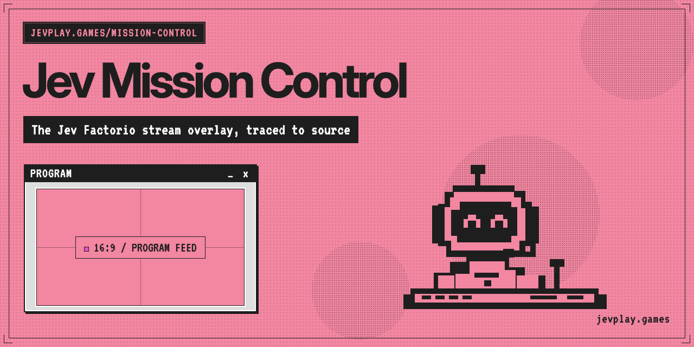

# Art

`factory-steel.png` and `jev-factorio-maintenance-v1.png` are AI-generated and used
as-is, with no edits. The README banner and social preview in [`../assets/`](../assets/)
are recorded at the end of this file. `jev-mission-control-overlay-live.png` is a screenshot, not
generated art.

## `factory-steel.png`

1254x1254 background texture for the Mission Control header and page. The page
covers it with a 92%-opaque dark tint, so data panels stay readable. Deployed at
`/opt/jev-mission-control/dashboard_assets/factory-steel.png`.

Generated with the built-in GPT image tool on 2026-09-21. Prompt, from upstream
`docs/DASHBOARD_ART.md`:

> Use case: stylized-concept. Asset type: subtle industrial texture for a Factorio-inspired live factory monitoring dashboard, not a dashboard mockup. Generate one square 1024x1024 flat, orthographic, edge-to-edge swatch of very dark charcoal, slightly olive-grey, worn painted steel. Restrained fine scratches, faint soot and extremely subtle aged metal grain; a hint of warm copper oxidation. Entire image has evenly distributed low contrast and no focal point, lighting is flat and diffuse, designed to repeat as a quiet background texture. Main palette near #292a25, darkest near #20221d, brightest below #494a3f. No objects, gears, pipes, bolts, frames, stripes, symbols, text, letters, logos, watermarks, numbers, UI, gradients to white, bright highlights or perspective. This will sit beneath an opaque-dark translucent tint so actual HTML text remains easy to read.

## `jev-factorio-maintenance-v1.png`

1672x941 "OFFLINE / MAINTENANCE" slate, dated 2026-09-24. It is shown by the OBS
scene **JEV - Maintenance** (image source "JEV Maintenance Image", driven by
`obs-maintenance-scene.lua`). Deployed at `~ubuntu/jev-obs/assets/`.
AI-generated; the generation prompt was not recorded with the file.

## `jev-mission-control-overlay-live.png`

1920x1080 screenshot of the live OBS program output (scene **JEV Mission Control**)
on 2026-09-28 at 00:33Z, while `761ffc8` was deployed and the fresh Factorio
2.0.77 game was running. It was taken with the
`screenshot.request` trigger in `jev-factorio.lua`, which calls
`obs_frontend_take_screenshot()`. OBS saved the original to
`/mnt/recordings/sts2/program/`. The game footage in it is Factorio (Wube Software).

## `assets/banner.png` (README banner)

2560x840 README banner in the jevplay.games pink/ink pixel-window style: the title
"Jev Mission Control", the Jev robot at a console, and PROGRAM, CURRENT OBJECTIVE and
RUN TIME windows. Used only at the top of the README; not deployed to the OBS VM.
Generated with Codex CLI (`codex exec --sandbox workspace-write`) on 2026-10-14. Codex
wrote the HTML source `assets/src/banner.html` (1280x420 CSS px, self-hosted OFL fonts
in `assets/src/fonts/`) and rendered it at 2x with headless Chromium. Exact prompt:

> Create assets/banner.png at exactly 2560x840 for the repo jev-factorio-mission-control. Palette: pink #F386A1 (background), ink #1E1E1E (text, borders, title bars), magenta #E551BA (highlight only), panel grey #DEDEDE (window bodies), paper #FEFEFE (inverted text, inner bevel). Charts only: blue #1F78A8, amber #E8A33D. Type: Inter 700 for the title (tight tracking), VT323 (fallback JetBrains Mono) for all other text. Style: flat retro-desktop pixel windows, no gradients and no photos; fine ink halftone dot grid (6px pitch, about 40% opacity) with a few denser circular halftone blobs; 1px ink inset frame; thin L-shaped crop marks at the four corners; windows have a grey body, a 2px paper inner bevel and a hard 3px ink drop shadow, plus an ink title bar with an uppercase name at left and `_ x` at right; a dotted uppercase ink tag at top-left with pink text. Keep the Jev robot mascot, redrawn flat in pink/ink pixel style. Do NOT use the TypeSafe logo mark. Do not use Factorio logos or game screenshots (Wube trademark).. Top-left tag: 'JEVPLAY.GAMES/MISSION-CONTROL'. Title: 'Jev Mission Control'. Subtitle on an ink bar in paper text: 'The live stream overlay, as deployed'. Chip row: '+OBS' '+Factorio 2.0' '+snapshot'. Right side: three overlapping pixel windows titled 'PROGRAM', 'CURRENT OBJECTIVE', 'RUN TIME': a small framed 16:9 placeholder labelled 'OBS COMPOSITION', a checkbox tree with [x] goals, and a stepped bar chart in ink/pink/blue/amber with a pixel clock '02:09'. Include the Jev robot redrawn flat in pink/ink pixel style wearing a headset at a console. Small bottom-right text in VT323: 'jevplay.games'. No TypeSafe logo, no Factorio logo or screenshots. Also write assets/src/banner.html as the HTML source used to render it. Implementation notes: build the image as HTML/CSS (the robot as inline SVG pixel art or CSS grid pixels) in assets/src/banner.html, laid out at 1280x420 CSS px, and render it at device scale factor 2 to exactly 2560x840 with a headless browser (e.g. npx playwright or Chrome --headless --screenshot) into assets/banner.png. Use the self-hosted OFL fonts already in assets/src/fonts/ via @font-face with relative URLs (fonts/inter-var.woff2 as Inter, weight 100-900, use 700; fonts/vt323.woff2 as VT323; fallback JetBrains Mono / monospace); no network font loading and wait for fonts before capturing. Keep all temporary scripts outside the repo (use /tmp) and only leave assets/banner.png and assets/src/banner.html in the repo; do not modify any other file. A Chromium binary is available at /Users/completetech/Library/Caches/ms-playwright/chromium-1248/chrome-mac-arm64/Google Chrome for Testing.app/Contents/MacOS/* (Chrome for Testing) if you need it; if headless rendering is impossible in your sandbox, still write the HTML source and say so.

## `assets/social-preview.png` (GitHub social preview)

1280x640 GitHub social preview (Settings → General → Social preview) in the same style:
the title, the line "The Jev Factorio stream overlay, traced to source", a PROGRAM
window and the Jev robot, with the footer `jevplay.games`. Not deployed to the OBS VM.
Generated with Codex CLI on 2026-10-14 from the HTML source
`assets/src/social-preview.html`, rendered at 1x with headless Chromium. Exact prompt:

> Create assets/social-preview.png at exactly 1280x640 for GitHub's social preview of jev-factorio-mission-control. Palette: pink #F386A1 (background), ink #1E1E1E (text, borders, title bars), magenta #E551BA (highlight only), panel grey #DEDEDE (window bodies), paper #FEFEFE (inverted text, inner bevel). Charts only: blue #1F78A8, amber #E8A33D. Type: Inter 700 for the title (tight tracking), VT323 (fallback JetBrains Mono) for all other text. Style: flat retro-desktop pixel windows, no gradients and no photos; fine ink halftone dot grid (6px pitch, about 40% opacity) with a few denser circular halftone blobs; 1px ink inset frame; thin L-shaped crop marks at the four corners; windows have a grey body, a 2px paper inner bevel and a hard 3px ink drop shadow, plus an ink title bar with an uppercase name at left and `_ x` at right; a dotted uppercase ink tag at top-left with pink text. Keep the Jev robot mascot, redrawn flat in pink/ink pixel style. Do NOT use the TypeSafe logo mark. Do not use Factorio logos or game screenshots (Wube trademark).. Keep all text inside a 40px safe margin. Tag: 'JEVPLAY.GAMES/MISSION-CONTROL'. Title: 'Jev Mission Control'. One line on an ink bar: 'The Jev Factorio stream overlay, traced to source'. Footer in VT323: 'jevplay.games' (exactly this spelling, no 's' before the dot). One pixel window titled 'PROGRAM _ x' with a 16:9 placeholder, and the redrawn Jev robot. No TypeSafe logo, no Factorio logo. Implementation notes: build it as HTML/CSS in assets/src/social-preview.html laid out at 1280x640 CSS px (the robot as inline SVG pixel art or CSS grid pixels; reuse the robot design from assets/src/banner.html if that file exists), use the self-hosted OFL fonts already in assets/src/fonts/ via @font-face with relative URLs (fonts/inter-var.woff2 as Inter weight 700; fonts/vt323.woff2 as VT323; fallback JetBrains Mono / monospace), no network font loading, wait for fonts, and render at device scale factor 1 to exactly 1280x640 with a headless browser (e.g. npx playwright or Chrome --headless) into assets/social-preview.png. Keep temporary scripts outside the repo (use /tmp); only leave assets/social-preview.png and assets/src/social-preview.html in the repo; do not modify any other file. A Chromium binary is available at /Users/completetech/Library/Caches/ms-playwright/chromium-1248/chrome-mac-arm64/Google Chrome for Testing.app/Contents/MacOS/* (Chrome for Testing) if you need it; if headless rendering is impossible in your sandbox, still write the HTML source and say so.
